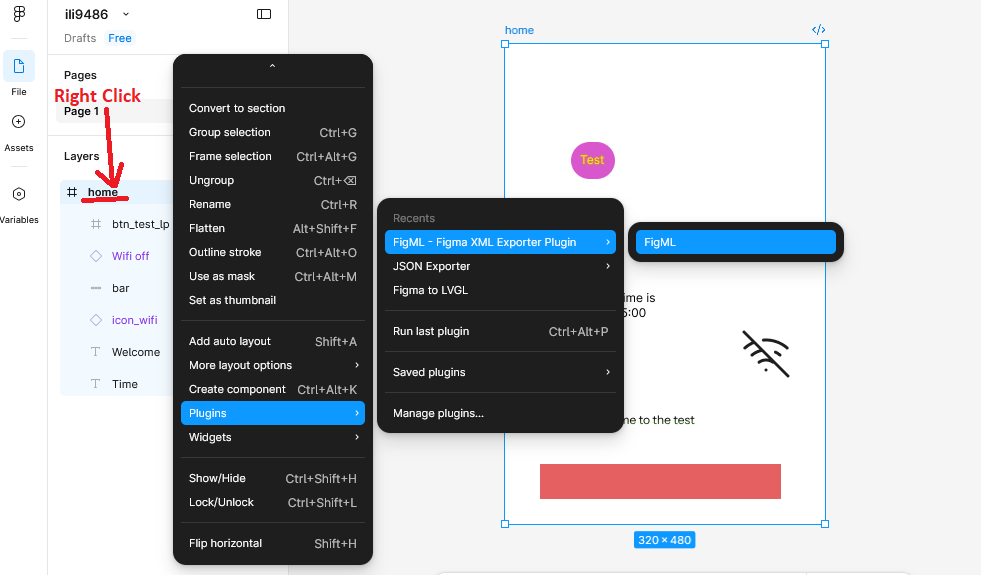

# figma2lvgl — Figma to LVGL C Code Generator

A **code-generation tool** that converts **Figma UI layouts** into
**LVGL C source files** ready to drop into any embedded project.

- Works with **any LVGL v9 project** (ESP-IDF, Zephyr, bare-metal, etc.)
- Installable via **pip** — no manual script setup
- Fully cross-platform — Windows, Linux, macOS

---

## ✨ Key Features

- 📐 Figma XML → Deterministic, reproducible C code
- 🎨 Figma styles (color, font, radius, border) → LVGL style calls, baked into the generated struct
- 🔤 Figma label text → baked into generated struct as design-time default
- 🧱 Per-screen typed C struct — firmware accesses `home.panel_top.time`, not `children[2]`
- 📦 Generates self-contained `ui_src/` folder
- 🧩 Buttons, sliders, bars, images, labels, panels, dynamic containers
- 🎯 Zero dynamic layout parsing at runtime
- 🔁 Named event callbacks — implement `ui_home_on_btn_ok_clicked()` and it just works

---

## 🚀 Installation

```bash
pip install figma2lvgl
```

### Prerequisites

- **Figma** with the **FigML — Figma XML Exporter** plugin installed
- **Python 3.10+**
- **LVGL 9.3** in your firmware project: the free, open-source library (MIT).
  LVGL Pro, LVGL's paid editor, is **not** needed; figma2lvgl doesn't use it.
  Image files are converted with LVGL's own `LVGLImage.py` from LVGL v9.3.0,
  which ships inside the package (MIT licence, provenance in its header).
  Nothing is downloaded. For a different LVGL version, pass that version's
  `LVGLImage.py` with `--lvgl-tool`.

### Upgrading from 0.4.x

0.5.0 changes what some Figma layers become and what some generated names
are. A design that compiled with 0.4.6 keeps its names unless it uses one of
the cases below; every case is listed with old and new names in
[CHANGELOG.md](CHANGELOG.md) under 0.5.0 → Breaking. In short:

- **Containers without a fill or stroke are no longer panels**, even when
  renamed (`Content`): they are dropped and their children move up a level,
  so their names lose that level (`ui_home_content_btn_ok_set_label` →
  `ui_home_btn_ok_set_label`). Name a container `panel_…` to keep it.
- **Keywords are whole words**: `toolbar_bg` is no longer a bar,
  `silicone_pad` no longer an image. They can now use any separator:
  `Btn OK` and `volume-slider` work.
- **Repeated names** are numbered `_2`, `_3`, … per parent, and the same
  name in two different panels is no longer renamed.
- **Widgets inside Groups and dropped frames are placed where Figma shows
  them.** 0.4.6 drew many of them at the wrong position or not at all.
- **Panels look like the Figma layer**: no LVGL theme background, border or
  padding.
- **Hidden layers** are no longer generated.

figma2lvgl prints a warning, naming the Figma layer, for every name it
changes or fixes. Run it on your design and read the warnings.

---

## 📖 Usage

```bash
figma2lvgl -x layout.xml
```

### All Arguments

| Argument | Description | Default |
|---|---|---|
| `-x` / `--xml` | Path to Figma XML file | **Required** |
| `-i` / `--images` | Folder containing PNG images | Same directory as XML |
| `-d` / `--dest` | Destination for generated output | Same directory as XML |
| `-y` / `--yes` | Skip the overwrite prompt | off |
| `--lvgl-tool PATH` | Use a different `LVGLImage.py` (for example a newer LVGL's) | bundled (LVGL v9.3.0) |
| `-f` / `--color-format` | PNG pixel encoding: `RGB565`, `RGB888`, `ARGB8888`, `L8` | `RGB565` |
| `--patch-esp-includes` | **Deprecated** — ESP-IDF include patching is now applied automatically to all generated image files. Flag kept for backward compatibility, has no effect. | — |
| `-v` / `--verbose` | Enable debug-level logging | off |
| `--verify-compile` | Syntax-check the generated C with `gcc` against real LVGL headers before replacing the output; a failed check keeps the previous output | off |
| `--lvgl-include PATH` | Include folder for `--verify-compile`: the LVGL folder with `lvgl.h`, and the one with `lv_conf.h` if separate. Repeat as needed | — |

> Outside ESP-IDF, define `LV_LVGL_H_INCLUDE_SIMPLE` in your build (for example
> `target_compile_definitions(... PUBLIC LV_LVGL_H_INCLUDE_SIMPLE=1)`), so the
> converted image files include `"lvgl.h"` like the rest of `ui_src/`.

### Examples

```bash
# Minimal — everything next to the XML
figma2lvgl -x layout.xml

# Full control
figma2lvgl -x layout.xml -i assets/images -d build/output

# CI pipeline (no prompts, 32-bit display)
figma2lvgl -x layout.xml --yes -f ARGB8888

# Check the generated C against your LVGL before replacing the output
figma2lvgl -x layout.xml --yes --verify-compile --lvgl-include ../lvgl --lvgl-include ./config

# ESP-IDF — no special flags needed, include patching is automatic
figma2lvgl -x layout.xml
```

---

## 📁 Output Layout

```
ui_src/
  src/              ← Generated screen .c files (one per Figma frame)
  include/          ← Generated screen .h files
  priv_src/         ← Converted image .c files + ui_style.c
  priv_include/     ← assets.h, ui_config.h, ui_defs.h, ui_style.h
```

Drop `ui_src/` into your project and add the source files to your build system.

**Regenerating is safe.** The new output is generated and checked next to
`ui_src/` (in `ui_src.staging/`) and only then swapped in, so a failed run
leaves the previous `ui_src/` exactly as it was. Files you add to `ui_src/`
yourself (for example a `CMakeLists.txt`) are kept across runs. A
`ui_src.lock` file next to it stops two runs from writing at once. If a run
was killed, the next run tidies up and tells you what it did.

> **Build system note:** ensure `priv_include/` is on the include path for
> **all** source files in `ui_src/`. ESP-IDF and Zephyr handle this automatically.
> For bare-metal Makefiles, add `-Iui_src/priv_include` to your CFLAGS.

### Using a generated screen

```c
#include "ui_home.h"

// Implement event callbacks in your application .c
// (linker error if missing — see Event Callbacks section below)
void ui_home_on_btn_ok_clicked(lv_event_t *e)    { /* navigate, update state */ }
void ui_home_on_btn_ok_long_pressed(lv_event_t *e) { /* hold action */ }

// In your app init:
ui_home_init();   // creates LVGL objects, applies styles, shows Figma text
ui_home_load();   // makes this screen active

// At runtime — update widgets:
ui_home_time_set_text("16:30");
ui_home_battery_bar_set_value(85, 300);   // animated over 300 ms
ui_home_icon_wifi_display();
ui_home_btn_ok_set_label("Confirm");
```

---

## 🎨 Designing in Figma

figma2lvgl reads the **Figma node name** to identify each UI element type and
**Figma styles** to generate matching LVGL style calls.

### Exporting XML from Figma

figma2lvgl reads XML exported via the **FigML — Figma XML Exporter Plugin**.

1. Right-click your frame in Figma
2. Go to **Plugins → FigML - Figma XML Exporter Plugin → FigML**
3. Export and save the `.xml` file
4. Pass it to figma2lvgl with `-x`


---

### Supported Widgets

figma2lvgl splits each layer name into words (separated by `_`, spaces,
hyphens or camelCase: `Btn OK`, `btn-ok`, `BtnOk` and `btn_ok` all give the
words *btn* and *ok*) and looks for type keywords among them. Keywords are
**whole words**: `toolbar` doesn't contain the keyword `bar`.

#### Text / Label

Any `Text` layer becomes an LVGL label. The text typed in Figma is the
initial value.

```
Figma layer:  Text (any name, e.g. "time", "welcome_label")
Maps to:      lv_label_create()
```

#### Button

First word `btn` or `button`. The button's text is its first `Text` child.

```
Figma name:   "btn_ok", "button_cancel", "Btn OK", "BtnSave"
Maps to:      lv_button_create()
```

**Event suffixes**: a last word that registers one more event.
`LV_EVENT_CLICKED` is always registered:

| Figma name | Events registered |
|-----------|----------------------|
| `btn_ok` | click |
| `btn_ok_lp` | click + `LV_EVENT_LONG_PRESSED` |
| `btn_ok_lpr` | click + `LV_EVENT_LONG_PRESSED_REPEAT` |
| `btn_ok_press` | click + `LV_EVENT_PRESSED` |
| `btn_ok_release` | click + `LV_EVENT_RELEASED` |

The suffix isn't part of the name: `btn_ok_lp` gives the field `btn_ok`.
Suffixes only apply to buttons, and only when something remains after the
keyword: `btn_press` is a button named `btn_press` (a label named
`time_click` keeps its full name too).

#### Image / Icon

A word `icon` or `image` anywhere in the name, or a component instance that
contains vector shapes.

```
Figma name:   "icon_wifi", "image_logo", "WifiIcon"
Maps to:      lv_image_create()
Asset:        icon_wifi.png in your images folder (named after the layer)
```

The PNG is named after the layer, so several layers named `icon_wifi` all
show `icon_wifi.png`. If they are instances of *different* components,
figma2lvgl stops with an error naming both; if it can't tell (plain layers),
it warns.

#### Bar

A word `bar` anywhere in the name. Put the range in the last two words:

```
Figma name:   battery_bar          → range 0–100 (default)
              battery_bar_0_100    → range 0–100, field "battery_bar"
              temp_bar_n20_50      → range −20–50 (n = negative)
Maps to:      lv_bar_create()
```

#### Slider

First or last word `slider` (before the range):

```
Figma name:   slider_volume, volume-slider
              brightness_slider_0_255  → range 0–255
              slider_rev_100_0         → reversed (LVGL supports min > max)
Maps to:      lv_slider_create()
```

#### Panel (Container)

A Frame with a visible fill or stroke, or any layer whose first word is
`panel`. Its children become nested struct fields. A leaf Rectangle or Frame
with a fill or stroke becomes an empty panel (a coloured box). A panel draws
only what the Figma layer has (no LVGL theme background, border or padding)
and clips its children only if the Frame has "Clip content" on.

```
Figma layer:  Frame with a visible fill or stroke, or "panel_…"
Maps to:      lv_obj_create()
```

Containers without a visible fill or stroke (Groups, plain Frames) are
**dropped**: their children are placed directly in the parent, at the
position Figma shows. Name a container `panel_…` to keep it as an
(invisible) panel, for example as a slot your firmware fills at run time.

#### Dynamic Container

First word `list` or `grid`: a scrollable container whose children are not
generated; firmware fills it at run time.

```
Figma name:   "list_devices", "grid_apps"
Maps to:      lv_obj_create() with LV_SCROLLBAR_MODE_AUTO
Accessor:     ui_home_get_list_devices() → returns lv_obj_t*
```

### Naming Rules Summary

| Widget | Name |
|--------|----------------|
| Label | Any `Text` layer |
| Button | First word `btn` or `button` |
| Slider | First or last word `slider` |
| Dynamic | First word `list` or `grid` |
| Bar | Word `bar` anywhere |
| Image | Word `icon` or `image` anywhere |
| Panel | First word `panel`, or a visible fill/stroke |

> **When two keywords meet**, the earlier row wins: `btn_slider` is a button,
> `bar_icon` a bar, `panel_btn` a panel. figma2lvgl warns which keyword it
> ignored.

> **Skipped layers:** hidden layers (with everything inside them), vectors,
> component instances without vector shapes, and leaf shapes with no keyword
> and nothing visible. Each skip is logged with the layer name and how to
> fix it.

> **Rotation** is not supported: a rotated layer is drawn unrotated, with a
> warning.

### Generated names

Each layer's name becomes a struct field: lowercased, with anything other
than letters and digits turned into `_` (`Brightness Slider` →
`brightness_slider`; camelCase is kept together, so `BatteryBar` →
`batterybar`). Functions are built from the screen name and the path of
fields: `ui_home_panel_top_time_set_text()`.

figma2lvgl fixes names that can't be used in C, and warns for each one:

| Layer name | Becomes | Why |
|---|---|---|
| `2nd row` | `label_2nd_row` | starts with a digit |
| `default`, `class` | `label_default`, `label_class` | C or C++ keyword |
| `style`, `text` | `label_style`, `label_text` | used by the generated struct |
| `lv_logo` | `image_lv_logo` | LVGL's own prefix |
| `★` | `label_1` | no usable characters |
| `title`, `title` (same parent) | `title`, `title_2` | repeated name |

The same name in two different panels is fine (`panel_a.title`,
`panel_b.title`). If two buttons share a name, their callbacks include the
parent: `ui_home_on_panel_a_btn_ok_clicked()`. Two frames that give the same
screen name (`Home` and `home`) are an error; a screen named `style`, `defs`
or `config` is renamed (`style_2`) because figma2lvgl's own files use those
names.

> **Nesting depth limits** — depth > 5 emits a warning; depth > 7 skips
> the subtree with an error. Aim for 2–3 levels in practice.

---

### Supported Styles

Styles applied in Figma are extracted and baked into the generated C struct.
`ui_apply_style()` is called at init time — no manual style code needed.

| Figma Property | Applies To | LVGL Call |
|---|---|---|
| Fill color | All widgets | `lv_obj_set_style_bg_color` |
| Fill opacity | All widgets | `lv_obj_set_style_bg_opa` |
| Text color | Labels, button labels | `lv_obj_set_style_text_color` |
| Font size | Labels, button labels | `lv_obj_set_style_text_font` |
| Corner radius | All widgets | `lv_obj_set_style_radius` |
| Stroke color | All widgets | `lv_obj_set_style_border_color` |
| Stroke weight | All widgets | `lv_obj_set_style_border_width` |
| Opacity | All widgets | `lv_obj_set_style_opa` |

> **Button text styles** are applied to the internal label child, not the
> button container — avoids relying on LVGL's style inheritance.

> **Text alignment** is not extracted — FigML does not export horizontal
> text alignment. LVGL's default (left) applies.

> **Multiple fills** — only the first visible fill is used. If you layer
> fills in Figma, set a single solid fill for the widget color.

#### Font Sizes

Figma font sizes are mapped to LVGL Montserrat fonts.
Supported: `10, 12, 14, 16, 18, 20, 22, 24`. Any other size falls back to `LV_FONT_DEFAULT`.

Enable only what your design uses in `lv_conf.h`:
```c
#define LV_FONT_MONTSERRAT_12  1
#define LV_FONT_MONTSERRAT_14  1
```

---

## 🔔 Event Callbacks

Every button and slider gets named event callback functions declared in its `.h`:

```c
// Declared in ui_home.h — you must implement these
void ui_home_on_btn_ok_clicked(lv_event_t *e);
void ui_home_on_btn_ok_long_pressed(lv_event_t *e);   // only if btn_ok_lp in Figma
void ui_home_on_brightness_slider(lv_event_t *e);
```

The generated `_init()` registers them with `lv_obj_add_event_cb()` automatically.
**You just implement the functions — no registration needed.**

```c
void ui_home_on_btn_ok_clicked(lv_event_t *e)
{
    lv_obj_t *btn = lv_event_get_target(e);
    ui_home_welcome_set_text("Button clicked!");
}
```

> **Linker error if not implemented.** If a callback is declared but you
> haven't defined it, the linker will report an undefined reference. This
> is intentional — it makes missing handlers explicit rather than silently
> doing nothing. Implement a no-op body if you don't need the callback yet:
> ```c
> void ui_home_on_btn_ok_clicked(lv_event_t *e) { (void)e; }
> ```

> **MSVC / Visual Studio:** `__attribute__((weak))` is not supported on MSVC.
> figma2lvgl does not use weak linking — callbacks are plain `extern` declarations,
> so the same linker-error model applies on all compilers including MSVC.

---

## 🧠 Architecture Overview

```
Figma XML + PNG assets
        │
        ▼
    figma_parser.py     reads XML → ParsedScreen / ParsedNode tree
        │
        ▼
    node_emitter.py     emits per-screen typed C struct + initializer
    init_emitter.py     emits flat BFS _init() body
    setter_emitter.py   emits setters + callback declarations
        │
        ▼
    generator.py        assembles .c and .h per screen
        │
        ▼
  ui_src/
    src/            ← ui_home.c, ui_settings.c, ...
    include/        ← ui_home.h, ui_settings.h, ...
    priv_src/       ← image .c files + ui_style.c
    priv_include/   ← assets.h, ui_config.h, ui_defs.h, ui_style.h
```

The generated struct mirrors the Figma hierarchy exactly:

```c
// Firmware accesses named fields — not generic arrays
s_home.panel_top.time.lv_obj
s_home.panel_top.icon_wifi.lv_obj
s_home.btn_ok.lv_obj
```

---

## 💡 Example Integrations

See the `examples/` folder for ready-to-use project setups:

```
examples/
  espidf/
    ili9486/        ← ESP32 + ILI9486 320×480 display (build steps in its README.md)
```

More platform examples (STM32, Zephyr, bare-metal) coming soon.

---

## 🧪 Development and Tests

The test sessions mirror CI. With [nox](https://nox.thea.codes/) installed:

```bash
nox                  # tests, compile, wheel
nox -s tests         # parser and generator tests
nox -s compile       # generated output compiled as C and C++ against LVGL 9.3
nox -s wheel         # build the wheel, install it offline, run it with no network
nox -s compile_msvc  # the compile check with MSVC (Visual Studio Developer prompt)
nox -s espidf        # build the ESP-IDF example (ESP-IDF terminal)
```

The compile session fetches LVGL v9.3.0 once into `.nox/`. To run the
compile tests directly, set `LVGL_DIR` to an LVGL checkout and run
`pytest tests/compile`.

The naming property tests use Hypothesis profiles: `ci` (50 examples, the
default), `full` (200, compiled) and `nightly` (200, random seed). Pick one
with `HYPOTHESIS_PROFILE=full`. After an intended change to the generated
output, regenerate the reference files with `python tests/regen_golden.py`
and review the diff.

---

## 🏁 Design Philosophy

| Principle | What it means |
|-----------|--------------|
| **Figma = layout + style** | All geometry, colors, fonts come from Figma — nothing hardcoded in C |
| **Naming = semantics** | Layer names (and visible fills) determine widget types; rename in Figma to change the generated widget |
| **Struct mirrors hierarchy** | Generated struct matches Figma's layer tree exactly — named fields, no generic arrays |
| **Output = portable C** | No dependencies beyond LVGL v9 |
| **Initial state = Figma** | Generated structs carry Figma text and styles as the design-time default; firmware updates from there |